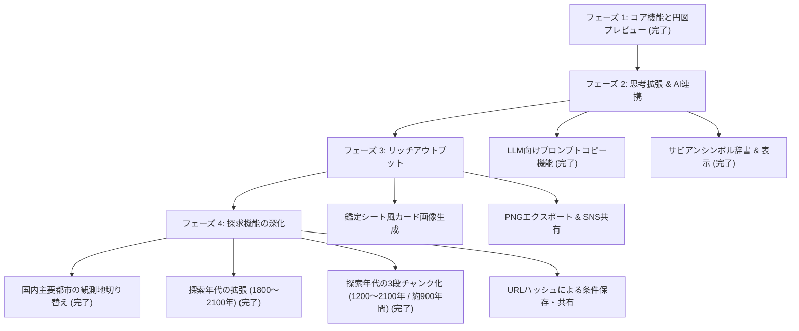

# 逆引きホロスコープ作成機（仮） — 構想・機能ロードマップ

本ドキュメントは、本ツールの強み・独自性を活かし、今後の機能拡張アイデアとその技術的実現性・制約を整理した構想メモです。

---

## 1. 現在の達成状況（コア機能の完成）

| 領域 | 実装済み機能 | 特徴・技術的強み |
| :--- | :--- | :--- |
| **探索エンジン** | 300年間（1800〜2100年）の区間演算 | 事前計算テーブル＋区間交差演算により、0秒（ノーウェイト）で全件探索 |
| **条件バリデーション** | サイン・アスペクトの残数リアルタイム表示 | 天文学的に矛盾する配置を事前に防ぎ、候補0件の無駄足をゼロにする |
| **アスペクト逆引き** | メジャーアスペクト・オーブ指定（必須/できれば） | 星同士の関係性・ドラマから該当日時を特定可能 |
| **ホロスコープ円図** | SVGによるネイタルチャート描画 | ASC左固定（世界標準）、12ハウスカスプ線、天体シンボル、アスペクト線 |
| **ハウスシステム** | プラシーダス方式 / イコールハウス方式 | スイス天文暦（Swiss Ephemeris）準拠の反復解法をJSで実装、ワンクリック切り替え |
| **対話型微調整** | 時間スライダー連動 | スライダー操作に追従して天球図が60fpsで滑らかに回転 |
| **観測地切り替え** | 国内主要10都市プリセット（札幌〜那覇） | ヘッダーからワンクリック切り替え、ASC・ハウス・注記・コピー文が即座に連動 |
| **アスペクト表** | 10天体の階段状三角マトリクス | スライダー連動で調和・緊張・合がリアルタイム点灯、ホバーで日本語詳細表示 |
| **鑑定シート生成** | 横長カルテ風の全画面モーダルUI | 2大テーマ（羊皮紙・宵の明星）、カスタム見出しラベル、サビアン詩行、アスペクト表統合 |
| **高解像度PNG出力** | ワンクリックでのRetina対応画像保存 | html2canvas同梱、Webフォント完全同期、2倍スケール、見切れ防止のアングル内周配置 |
| **UIレイアウト** | 3カラム独立スクロール（100vh） | ミニマル・フラット・モダンな静かなダークテーマ |

---

## 2. 新機能のアイデア構想 & 技術的レビュー

Mさんからいただいた素晴らしいアイデア群について、**「魅力・メリット」**と**「技術的な制約・必要な前提条件」**を誠実に整理しました。

### ① チャートの解釈ポイント入り「鑑定シート風画像」の作成機能 (完了)
* **概要**：
  ホロスコープ円図＋天体度数一覧＋ユーザーが記入したコメント（性格、物語上の設定、解釈ポイントなど）を、1枚の美しいカード画像（PNG / WebP）として書き出し・保存できる機能。
* **実装内容（2026年10月17日完了）**：
  * **2つの世界観テーマ**：
    * 📜 **黄昏の羊皮紙（Parchment）**: `Cardo` × `しっぽり明朝`（アンティークゴールド・バーガンディの洋古書風）。
    * ✨ **宵の明星（Hesperus）**: `DM Mono` × `Kiwi Maru`（深遠な群青×星光アイスブルー・星屑ドット）。
  * **自由度の高いカルテ編集**：表題・キャッチコピーに加え、解釈コメントの見出しラベル（`【風景】` `【結び目】` `【深層】` 等）をユーザーが自由に打ち替え可能。
  * **高解像度PNGダウンロード**：`html2canvas.min.js` をローカル同梱し、`document.fonts.ready` 同期＆2倍解像度（Retina）で鮮明なPNG画像を瞬時にダウンロード保存。アングル（ASC/DSC/MC/IC）も円図内周に美しく収め、見切れを完全防止。
* **魅力**：
  SNS（X等）への投稿、創作キャラクターの設定資料としての保存・印刷に最適。単なるツールから「作品を生み出すスタジオ」へ進化します。
* **技術的実現性と制約**：
  * **実現性**：`HTML5 Canvas` または SVGを画像化する標準機能（`toDataURL` / `OffscreenCanvas`）で、ブラウザ内完結で実装可能です（サーバー不要）。
  * **考慮すべき制約**：
    * 日本語フォントのレンダリング（Webフォントが画像書き出し時に正しく適用されるよう、フォントのロード完了待機の制御が必要）。
    * 高解像度（Retinaディスプレイや印刷に耐える2倍〜3倍解像度）でのシャープな描画処理。
    * レイアウト枠（文字数が多いときの自動縮小や折り返し）。

---

### ② LLM（AI）サービス向け「プロンプト一体型」コピー機能
* **概要**：
  ChatGPT、Claude、Gemini などのチャットAIにそのまま貼り付けるだけで、的確なキャラクター解釈や星読みを行ってもらえる**「AI専用プロンプト形式」**でクリップボードにコピーする機能。
* **魅力**：
  占星術の知識が浅い創作者でも、「この星の配置がどんな性格や運命を意味するのか」をAIにすぐ深掘りしてもらえます。
* **技術的実現性と制約**：
  * **実現性**：**極めて高く、即座に実装可能**（外部APIやサーバー通信は不要で、純粋なテキスト整形のみ）。
  * **出力フォーマットの例**：
    ```text
    【依頼】
    以下のホロスコープ配置を持つ創作キャラクターの「性格」「長所・短所」「対人関係の特徴」を分析してください。

    【基本情報】
    日時: 1995年4月5日 14:30 (JST) / 観測地: 東京
    ハウスシステム: プラシーダス

    【天体配置】
    太陽: 牡羊座 14°32' (第9ハウス)
    月: 獅子座 21°10' (第1ハウス)
    ...

    【主要アスペクト】
    太陽 △ 月 (トライン / オーブ 2°20')
    ...
    ```

---

### ③ サビアンシンボル表示機能
* **概要**：
  黄道360度（12サイン × 30度）の各度数に割り当てられた詩的な象徴詩（サビアンシンボル）を、天体詳細やホロスコープ図上に表示する機能（例：牡羊座15度「毛布を編むインディアン」など）。
* **魅力**：
  サインやハウスだけでは語りきれない、キャラクターの深層心理や細やかなモチーフ設定のインスピレーションが爆発的に広がります。
* **技術的実現性と制約**：
  * **実現性**：度数の端数を切り上げる計算ルール（例: 14°01' → 15度）を適用し、度数に対応するテキスト辞書を参照するだけで高速に動作します。
  * **考慮すべき前提条件**：
    * **データ著作権への配慮**：書籍等で独自翻訳された現代の解説文は著作権保護対象となるため、マーク・エドモンド・ジョーンズ／ディーン・ルディアの原典（パブリックドメイン扱い）をベースにした標準的・客観的なシンボル名・キーワードのデータセットを構築する必要があります（データ容量は約50〜80KB程度でブラウザ内保持可能）。

---

### ④ 観測地（都市）の変更機能 (完了)
* **概要**：
  現在は「東京」固定になっていた観測地点を、国内主要10都市（札幌、仙台、東京、金沢、名古屋、京都、大阪、広島、福岡、那覇）からヘッダーのプルダウンで即座に切り替え可能にする機能。
* **実装内容（2026年10月16日完了）**：
  * ヘッダーのトップバーに「観測地」および「標準時（JST）」の専用セレクトボックスを新設。
  * 観測地の変更に連動して、ASC・MC・ハウスカスプ・各天体の属するハウス、円図の回転、詳細注記、およびAI用プロンプト・テキストコピーが即座に再計算・再描画される。
  * `localStorage` への保存にも対応し、ブラウザ再読込後も選択状態を保持。
* **今後の課題（海外都市への拡張時）**：
  * 海外都市を扱う場合、タイムゾーン（UTCオフセット）や夏時間（サマータイム）の動的判定・データセットの導入が必要となります。

---

### ⑤ 探索年代の拡張（前後300年規模への拡大）
* **概要**：
  現在の「1900年〜2050年（150年間）」から、例えば「1800年〜2100年（300年間）」程度まで探索範囲を広げ、近代文学や明治・大正・昭和初期の舞台設定、近未来SF創作などを幅広くカバーする。
* **魅力**：
  現代劇だけでなく、歴史的背景を持つキャラクターや少し先の未来のキャラクターまで、本ツールの「0秒全件探索」の強みのまま探せるようになります。
* **技術的実現性と制約**：
  * **前後300年規模（1800〜2100年等）の実現性**：
    * **極めて高く、現行アーキテクチャのまま拡張可能**。データサイズは約800KB（圧縮時約150KB）程度と軽量で、初回の読み込み速度や探索パフォーマンスを犠牲にすることなく実現できる見込みが高いです。
  * **さらに超広域（数千年規模・紀元前など）を目指す場合の将来課題**：
    * データ量の約7割を占める「月」のデータが肥大化するため、一括読み込みではなく「**100年単位のオンデマンド分割読み込み（チャンク方式）**」や「**遅い星＋逐次計算のハイブリッド方式**」といったアーキテクチャの再設計が必要になります。
    * また、1582年以前のユリウス暦/グレゴリオ暦の改暦対応や、長期の自転速度揺らぎ（ΔT）による天文学的計算誤差の検証が前提条件となります。

#### 📌 方針決定（2026年10月16日）：中間案を採用
* **基本スタンス**：実際の用途（創作キャラクターの誕生日探し）に合わせて**今の強み（0秒全件探索）を最優先**しつつ、将来もっと広い年代（汎用的な天文日時逆引き）へ拡張できる**余地だけを先に確保**する。
* **具体的な進め方**：
  1. **データ読み込み部分の切り出し**：探索エンジンが年代データを直接参照せず、読み込み用の窓口関数（例：`getTable(year)`）を一つ通す構造に整理する。将来チャンク方式へ移行するときは、この窓口の中身を差し替えるだけで済むようにする。
  2. **実測による検証**：前述の「約800KB（圧縮時約150KB）」は**試算値で未検証**。1800〜2100年分のデータを実際に生成し、ファイルサイズ・初回読み込み時間・探索速度を測ってから本採用を判断する。
  3. **1800〜2100年への拡張**：実測で問題がなければ、データ形式や探索の仕組みは今のまま範囲を広げる。
* **今回は見送るもの**：改暦対応、ΔTの長期検証、チャンク方式の実装（必要になった時点で着手）。

#### 🔍 コード調査の結果（2026年10月16日）
**1. データの読み込み口は、すでに1か所にまとまっている**
* 流れ：`index.html` の `<script>` → `window.RH_EPHEMERIS` → `app.js` で `createEngine(DATA)` を1回呼ぶだけ。
* `engine.js` は、渡されたデータの開始時刻と期間の長さ（`epochUtcMs` / `rangeMinutes`）だけを見て動く。年代の数字はコードに書かれていない。
* 円図の度数（`astro.js`）とアスペクト探索（`aspects.js`）は事前計算データを使わず、その場で計算している。年代の制限を受けない。
* ブラウザ（localStorage）に保存しているのは条件と表示設定のみで、時刻は保存していない。開始年を変えても保存済みの状態は壊れない見込み。
* → 先に `getTable(year)` のような窓口を新しく作る必要は、ほぼない。将来チャンク方式にする場合も、分割したデータを今と同じ形につなぎ合わせて渡せば、エンジン側の変更は小さく済む**見込み**（未検証）。

**2. 1800〜2100年へ広げるときに直す箇所**

| 場所 | 内容 |
| :--- | :--- |
| `tools/generate-ephemeris.mjs` L22-26 | 開始年・終了年の定数 |
| `js/app.js` L426-427 | 「1900年以前から継続」「2050年以降も継続」の文字が直書き |
| `index.html` L7, L36 | 説明文とヘッダーの「1900 – 2050」 |
| `tools/verify.mjs` | 検証の基準値が1900〜2050年分のみ。新しい年代の基準値の追加が必要 |

* 準備として、データに開始年・終了年を持たせ、表示の文字をそこから作るように直しておくと、以後の年代変更はデータの再生成だけで済む。

**3. データサイズと探索速度の実測結果（1800〜2100年・300年間分）**
* 生成スクリプトによる実測値（2026年10月16日実施）:
  * **生ファイルサイズ**: **708.4 KB** (725,440 bytes)
  * **gzip圧縮後サイズ**: **245.0 KB** (250,853 bytes) ※Webフォント1つ分程度で極めて軽量
  * **全10天体のサイン残数計算 (`signCounts`)**: 平均 **0.97 ms**（1ミリ秒未満）
  * **複合逆引き検索 (Sun必須 + 3天体できれば)**: 平均 **0.37 ms**（1,189件を瞬時に検出）
* **結論**: 300年間に拡張しても「0秒全件探索」「リアルタイムな残数フィードバック」のパフォーマンスは完全に維持可能であることが実証された。

**4. 年代を広げるときに注意が必要な、暦と時刻の決まり**
* 日本標準時の開始は**1888年（明治21年）**。それ以前の「日本時間○時」は、現在の表示とは意味が変わる。生成データは全期間をUTC+9で固定している。
* 日本のグレゴリオ暦（新暦）への切り替えは**1873年（明治6年）**。それ以前の日付は旧暦で考えることが多く、ツールが示す新暦の日付とずれる可能性がある。
* 計算自体は動いても、作品設定に使う際に混乱しやすい点。ツール本体とは別に、注意書きを置く方針を検討中。

**5. アイデア（未決定）：Tips・解説ページ**
* 暦と時刻の注意（旧暦・標準時）は、ツール画面に詰め込まず、**専用のTipsページ**にまとめる案。
* 同じページに、簡単な占星術の基礎知識（サイン・ハウス・アスペクトの説明など）も置ける。
* 実装時期・置き場所（同一サイト内 / 別ページ）は未定。

#### 📊 天体別データ量の実測と、チャンク分割の構想（2026年10月16日）
**1. 実測：天体ごとのデータ量（現在の151年分・合計約350KB）**

| 天体 | イングレス件数 | データ量の割合 |
| :--- | ---: | ---: |
| 月 | 24,224 | **76.3%** |
| 水星 | 2,238 | 7.1% |
| 金星 | 1,913 | 6.0% |
| 太陽 | 1,812 | 5.7% |
| 火星 | 1,037 | 3.3% |
| 木星 | 231 | 0.7% |
| 土星 | 128 | 0.4% |
| 天王星 | 61 | 0.2% |
| 海王星 | 37 | 0.1% |
| 冥王星 | 35 | 0.1% |

* 「データの約7割が月」という見立てはほぼ正しかった。
* 太陽・水星・金星・火星で約22%、木星〜冥王星の5天体は合計でも約1.5%。

**2. 「全部の場合分けを考慮している」わけではない**
* `engine.js` は、選んだ条件の期間リストを、動きの遅い天体から順に重ねる方式。月の条件を選ばなければ、月のデータは探索に使われない。
* 月の重さが効くのは主に次の2点：
  * ダウンロードとメモリの量
  * `app.js` L321 で、条件を変えるたびに全天体の「サイン別の残数」を計算している（月の約2.4万件も毎回含まれる）
* 後者が実際にどの程度の負荷かは**未測定**。

**3. 構想：天体ごとにチャンクの大きさを変える（未検証）**
* データの形式（天体ごとに独立した「サインが変わった時刻の一覧」）自体は、ほぼそのまま使える見込み。天体ごとにファイルを分ける形とは相性がよい。
* 変更が必要になりそうな部分：
  1. **全天体が同じ期間を持つ前提の見直し**：現在は `rangeMinutes` が1つで、全天体が同じ範囲を覆っている。天体ごとに「読み込み済みの範囲」を持たせる。
  2. **探索可能範囲のルール**：条件に使う天体の読み込み済み範囲の共通部分とする、など。
  3. **チャンクの境目のつなぎ**：サインの途中で切れるため、前のチャンク末尾と次のチャンクの `s0`（開始時のサイン）が同じなら、1つの期間に結合する処理が必要。
  4. **月が未読み込みのときの残数表示**：読み込んでから計算するか、「未計算」と表示するかを決める。
* 分け方の案：外惑星（木星〜冥王星）は全体の約1.5%で、広く持たせても節約効果は小さい。大きく効くのは**月（76%）**と**太陽・水星・金星・火星（約22%）**の2グループ。「月だけ別チャンク」と「それ以外をまとめて持つ」の2段構成が現実的かもしれない。
* 参考：300年分に単純換算すると、月が約530KB、それ以外が約170KB。
* 上記はコードを読んだうえでの見立てで、**実際に動かして確かめたものではない**。実測（圧縮後サイズ・読み込み時間・探索速度）の結果次第で、300年を1チャンクで持つ方針に落ち着く可能性もある。

---

## 3. 今後の開発フェーズ（提案ロードマップ）

焦らず、使いやすさと品質を両立させながら進めるステップです：



---

*作成日: 2026年10月15日*
*プロジェクト: 逆引きホロスコープ作成機（仮）*
